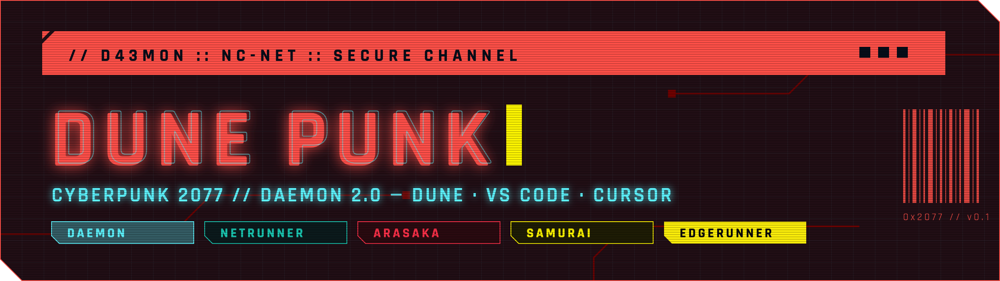
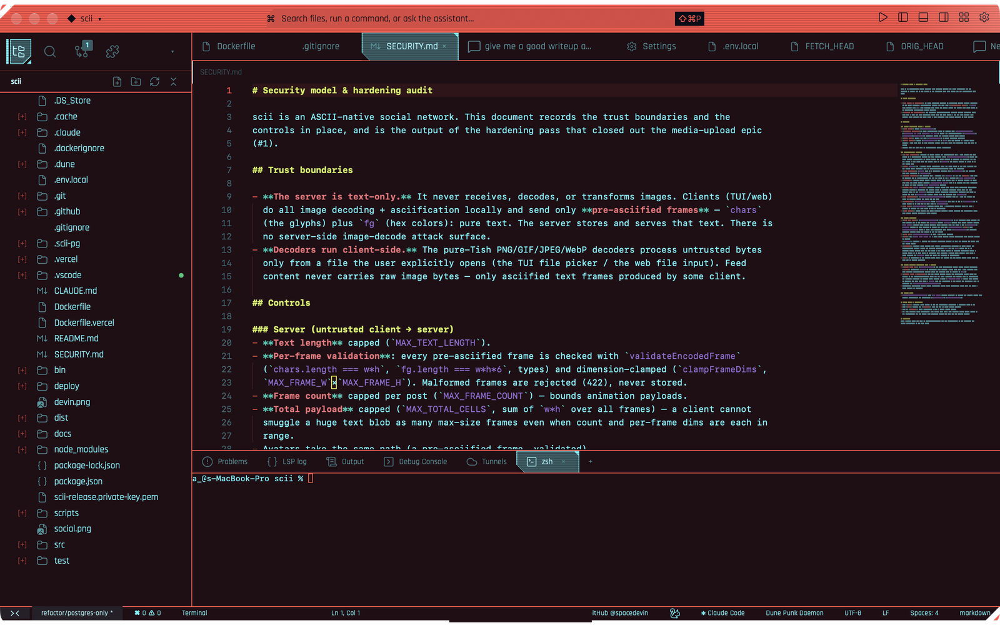
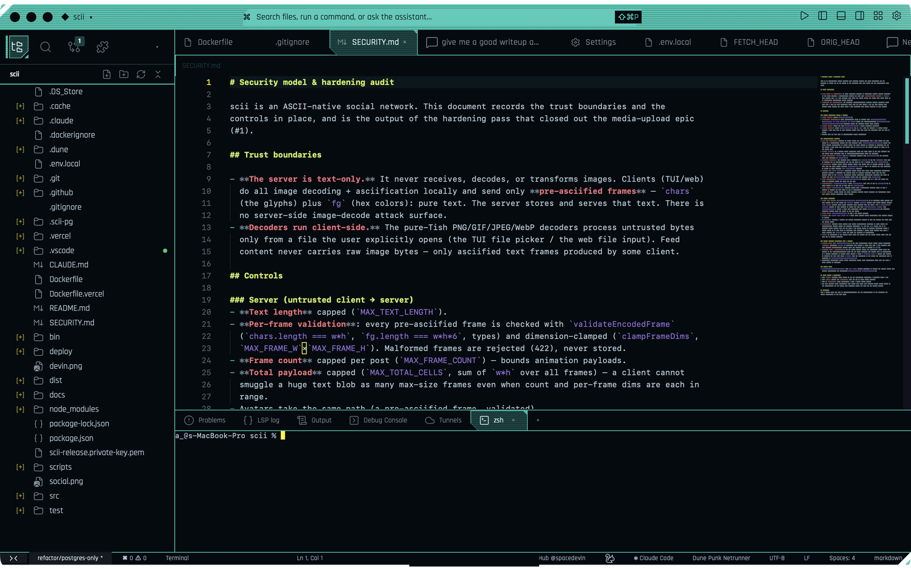
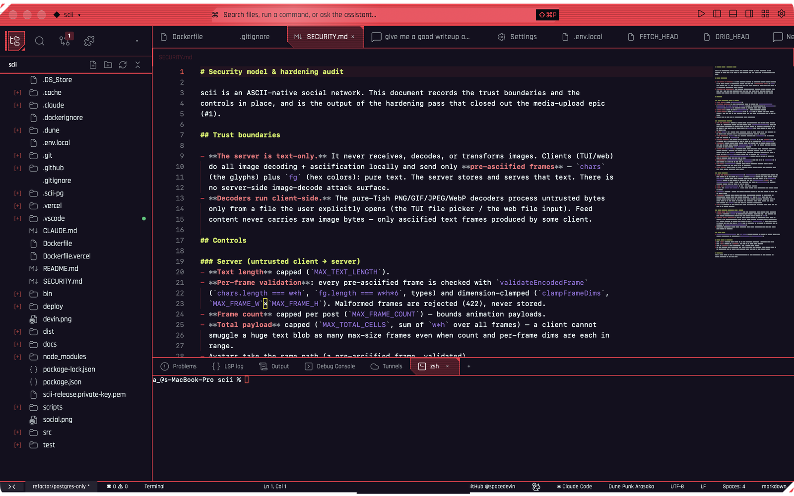
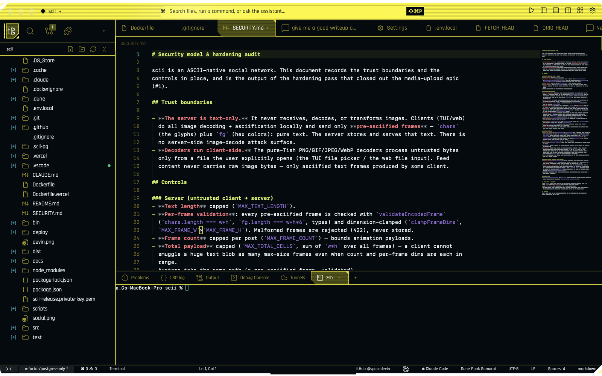
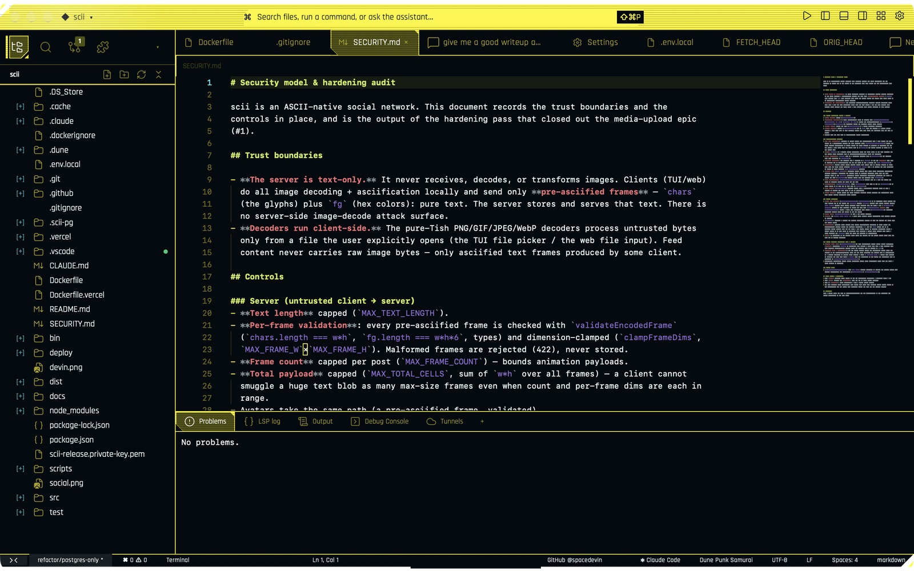

<p align="center">
  
</p>

<p align="center">
  <a href="https://open-vsx.org/extension/spacedevin/dune-punk"></a>
  <a href="https://open-vsx.org/extension/spacedevin/dune-punk"></a>
  <a href="LICENSE"></a>
</p>

<p align="center"><b>Wake up, Samurai. The city needs a commit.</b></p>

**Dune Punk** is a Cyberpunk 2077 theme collection built on the palette of
[Daemon 2.0](https://github.com/MathisP75/daemon-kde-mk2): five color themes and two icon themes.
In VS Code, VSCodium and Cursor you get the full editor, terminal and workbench colors. In
[Dune](https://dune.you) the whole app turns into a Kvantum HUD — a salmon title band with cut corners,
one-color outlined buttons with a detached bar, chamfered tabs and cards with corner ticks, a
transparent window, scanlines and HUD motion.



## Five ways to jack in

| | |
|---|---|
| **Daemon** — the original: neon cyan type on burgundy night, salmon frames, slate-teal selection, Konsole terminal hues.<br><br>    |  |
| **Netrunner** — deep-net black, cyan ICE frames, magenta intrusion code.<br><br>    |  |
| **Arasaka** — corporate red on indigo-black, yellow keys.<br><br>    |  |
| **Samurai** — the 2077 HUD: a yellow command band, red accents, cyan data.<br><br>    |  |
| **Edgerunner** — three colors, zero chill: volt, ice and blood on void, a cyan grid, per-panel accent edges.<br><br>    |  |

Plus two icon themes (≈100 SVGs each):

- **Dune Punk Icons** (`dune-punk-icons`) — color-coded cut-corner hex badges and chamfered folders.
- **Dune Punk Circles** (`dune-punk-circles`) — the Daemon-Icons look: cyan line glyphs in rings.

## Install

From [Open VSX](https://open-vsx.org/extension/spacedevin/dune-punk):

```sh
dune --install-extension spacedevin.dune-punk
```

In VS Code, VSCodium or Cursor, search the extensions view for **Dune Punk**.

### What you get where

| | Dune | VS Code / VSCodium / Cursor |
|---|---|---|
| Editor, syntax, terminal, git, diff colors | ✓ | ✓ |
| Workbench colors (side bar, tabs, status bar, menus, inputs) | ✓ | ✓ |
| Icon themes (`dune-punk-icons`, `dune-punk-circles`) | ✓ | ✓ |
| Chamfered frames, Kvantum buttons / inputs / tabs, title band, scanlines, motion | ✓ | — |
| Transparent window, per-panel accent edges (Edgerunner) | ✓ | — |

The Dune-only parts live in `dune.*` color keys and top-level theme fields that other editors ignore.

## Publishing

Releases are automatic. Every push to `main` runs [tishlang/sem](https://github.com/tishlang/sem): it reads the
[conventional commits](https://www.conventionalcommits.org) since the last tag (`feat` → minor, `fix` / `perf` → patch,
`!` / `BREAKING CHANGE` → major; `chore` / `docs` / `ci` don't release), tags `vX.Y.Z`, writes the GitHub release
notes, and the same workflow packages that version and publishes it to Open VSX (the `.vsix` is attached to the
release too). Pushes to other branches and PRs only build and package.

Open VSX auth: the `OVSX_PAT` repository secret while it exists; after this workflow is registered as the
`spacedevin` namespace's trusted publisher, delete the secret and releases use GitHub OIDC.

## Design notes

- **No radii.** Every corner is square or cut at 45°. Chamfers, corner ticks and detached accent bars are
  gradients on Dune's shape tokens, so they cost nothing at runtime.
- **One line, never two.** Panes are separated by a single 1px frame-colored rule; Edgerunner floats
  its panels on a grid instead, each with its own accent edge.
- **Kvantum controls.** Buttons are one-color outlines with a detached left bar and a cut corner;
  toggled / primary controls fill teal with a cyan tick. Inputs, tabs, menus, dialogs and the chat
  composer share the same cut-corner card.
- **Motion.** A glitch on hover, a neon flicker on selection, a slow scan sweep across the title band.
  All of it is off under `prefers-reduced-motion`.
- **Every device shell.** Themes only supply tokens; Dune's layout handles desktop, iPad, iPhone and
  foldable postures, so the same theme applies everywhere.

## Build

```sh
node build.mjs
```

This regenerates `themes/*.json` and `icons/` from `palette.mjs` + `variants.mjs`, then validates:

- every `dune.*` key against Dune's `schemas/dune-theme-keys.json` (when the dune-ide checkout is
  at `~/Projects/dune/dune-ide`)
- every standard key is `#hex` (Dune drops anything else)
- WCAG AA contrast (4.5:1) on text, tab, title-bar, accent, and segment pairs

## License

MIT. Color assignments follow Daemon 2.0 by MathisP75 (GPL-3.0); no artwork from that project is
included. Fan work; not affiliated with CD PROJEKT RED.
